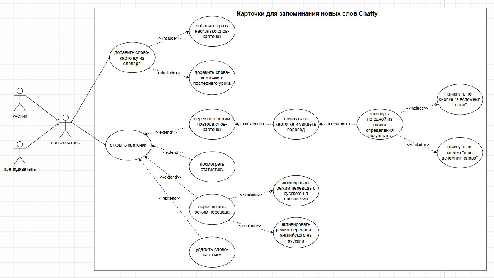

# Разработка требований

## Контекст
Chatty — это детская языковая онлайн-школа. Компания решила расширяться и работает над веб-приложением для первого взрослого курса. 

Команда разработки выпустила первую версию веб-приложения Chatty. После запуска отдел маркетинга провёл анализ конкурентов — других онлайн-школ английского языка. Выяснилось, что у Chatty есть заметное преимущество, которое привело к успеху первой версии приложения, — индивидуальный и тщательный подбор преподавателей. Но есть область, где Chatty пока сильно отстаёт: у большинства конкурентов есть функции словаря и карточек для запоминания слов. Поэтому перед проектированием и созданием второй версии ПО команде Chatty нужно разработать требования к словарю и карточкам. 

## Задача
Подготовить описание функции карточек для запоминания новых слов во второй версии приложения Chatty. 
Чтобы описать функцию карточек, нужно выявить варианты использования и описать их:
- в виде диаграммы в нотации UML Use Case
- в виде табличной формы Use Case с описанием всех полей по Алистеру Коберну

## Решение

| **Уникальный код и название** | **ВИ-1: Добавить слово-карточку из словаря** |
| --- | --- |
| Контекст использования | Добавление нового слова в Карточки для запоминания новых слов |
| Область действия | Веб-приложение Chatty |
| Уровень | Цели пользователя |
| Основное действующее лицо | Ученик |
| Предусловие | • Пользователь авторизован в Chatty • В словаре есть как минимум одно слово-карточка • В словаре есть искомое слово-карточка |
| Минимальные гарантии успеха | Слово-карточка из словаря не добавлена |
| Гарантии успеха | • Слово-карточка добавлена в раздел Карточек для запоминания • Слово-карточка уже есть в разделе Карточек для запоминания |
| Триггер | Пользователь хочет добавить слово в раздел Карточек для запоминания |
| Базовый сценарий | Добавить слово-карточку  в раздел Карточек для запоминания |
| 1 | Пользователь выбирает нужное слово-карточку |
| 2 | Пользователь выбирает действие добавления слова-карточки в раздел Карточек для запоминания |
| 3 | Система добавляет слово-карточку в раздел Карточек для запоминания |
| Расширения | Слово-карточка есть в разделе Карточек для запоминания |
| 1а | Система информирует о том, что слово-карточка ранее уже добавлено в раздел Карточек для запоминания |
| 1а1 | Система возвращается на шаг 1 основного сценария |
| Изменения в технологии и данных | Использовать подключаемый раздел Карточек для запоминания |

| **Уникальный код и название** | **ВИ-2: Открыть карточки** |
| --- | --- |
| Контекст использования | Открыть Карточки для начала тренировки или для совершения иных действий (посмотреть статистику карточек, переключить режим перевода, удалить ненужное слово) |
| Область действия | Веб-приложение Chatty |
| Уровень | Цели пользователя |
| Основное действующее лицо | Ученик |
| Предусловие | Пользователь авторизован в Chatty |
| Минимальные гарантии успеха | Раздел Карточек недоступен |
| Гарантии успеха | • Раздел Карточек недоступен • Раздел Карточек открыт |
| Триггер | Пользователь хочет перейти в раздел Карточек (чтобы потренироваться в запоминании новых слов или совершить иные действия) |
| Базовый сценарий | Пользователь переходит в раздел Карточек |
| 1 | Пользователь находится на Главной странице веб-приложения Chatty |
| 2 | Пользователь кликает по разделу Карточек |
| 3 | Пользователь попадает в раздел Карточек |
| Расширения | Раздел Карточек недоступен |
| 3а | Система отображает пользователю уведомление о недоступности раздела |
| 3а1 | Система возвращается на шаг 1 основного сценария |
| Изменения в технологии и данных | Использовать подключаемый раздел Карточек для запоминания |

| **Уникальный код и название** | **ВИ-3: Посмотреть статистику** |
| --- | --- |
| Контекст использования | Просмотр статистики по разделу Карточек для запоминания |
| Область действия | Веб-приложение Chatty |
| Уровень | Цели пользователя |
| Основное действующее лицо | Ученик |
| Предусловие | Успешно выполнен базовый сценарий варианта использования “Открыть карточки” |
| Минимальные гарантии успеха | Статистика по Карточкам недоступна |
| Гарантии успеха | Статистика по Карточкам показана пользователю |
| Триггер | Пользователь хочет узнать о статистике его взаимодействия с разделом Карточек (включая нулевые данные) |
| Базовый сценарий | Посмотреть статистику |
| 1 | Пользователь находится в разделе Карточек для запоминания |
| 2 | Система отображает статистику |
| 3 | Пользователь просматривает статистику |
| Изменения в технологии и данных | • Использовать подключаемый раздел Карточек • Собирать данные о действиях пользователя • Сохранять данные в СУБД PostgreSQL • Формировать/обновлять по ним мини-отчёт • Отображать актуальный мини-отчёт в веб-приложении |
