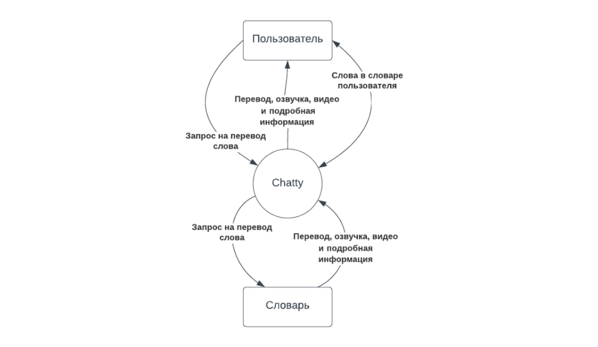
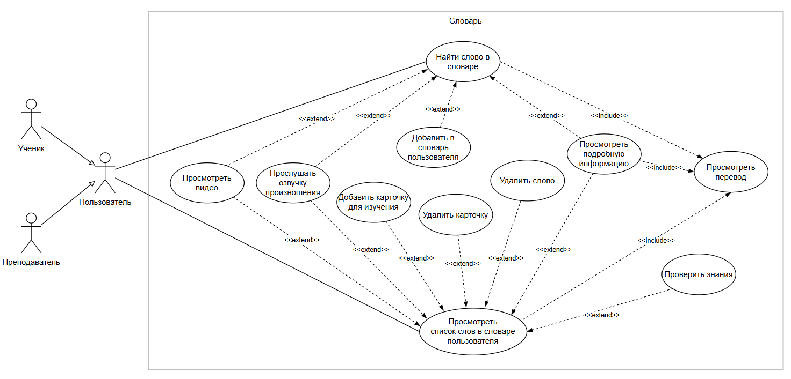

# Спецификация требований ко второму релизу Chatty

## Контекст
Chatty — это детская языковая онлайн-школа. Компания решила расширяться и работает над первым взрослым курсом. 

Команда разработки выпустила первую версию веб-приложения Chatty. Системный аналитик компании начал составлять основу спецификации требований для второго релиза. Но в процессе был подготовлен новый функционал (по карточкам для запоминания слов), ещё не учтенный в документе. А также появились новые требования от CEO компании (по добавлению видео). Всё это нужно учесть в спецификации требований ко второму релизу.

## Задача
Необходимо завершить спецификацию требований к ПО для второго релиза Chatty. 

Задачи:

1. Дополнить спецификацию функциональными требованиями для функции карточек для запоминания новых слов.
2. Описать требования к новой функции просмотра видео. Для этого необходимо:
   - обновить диаграмму UML Use Case;
   - добавить новые табличные варианты использования;
   - написать функциональные требования для функции видео.
3. Также для новой функции просмотра видео необходимо заполнить другие разделы спецификации:
   - атрибуты качества;
   - бизнес-правила;
   - глоссарий.

## Решение
---------------------------------------------------
# Спецификация требований к ПО Chatty 2.0 
---------------------------------------------------
# 1. Введение

## 1.1 Цель
Эта спецификация требований к ПО описывает функциональные и нефункциональные требования к версии 2.0 веб-приложения Chatty. Этот документ предназначен для команды, которая будет реализовывать и проверять корректность работы веб-приложения. Кроме специально обозначенных случаев, все указанные здесь требования имеют высокий приоритет и приписаны к версии 2.0.

## 1.2 Соглашения, принятые в документе
В этой спецификации нет никаких типографских условных обозначений.

## 1.3 Границы проекта
Вторая версия веб-приложения Chatty позволит ученикам и преподавателям использовать словарь и карточки для изучения слов в работе с веб-приложением. Детальное описание второй версии приведено в спецификации требований к ПО, где перечислены функции, полная или частичная реализация которых запланирована в этой версии.

## 1.4 Ссылки
1. Артём Артёмов. Спецификация требований к ПО Chatty 1.0

# 2. Общее описание

## 2.1 Общий взгляд на продукт

    
     
    Рисунок 1. Контекстная диаграмма для версии 2.0 веб-приложения Chatty

     
## 2.2 Классы пользователей и их характеристики

| Класс пользователя | Описание |
|---|---|
| Ученик | Пользователь Chatty, изучающий английский язык. В среднем, ученик использует ПО два раза в неделю. Всего в Chatty 542 активных ученика, средний возраст ученика - 22 года. Ученик должен посещать назначенные в расписании уроки и выполнять домашнее задание. |
| Преподаватель | Пользователь Chatty обучающий английскому языку. В Chatty 53 преподавателя, в среднем преподаватель использует ПО 7 часов в день, средний стаж преподавателя - 4 года. Большинство преподавателей работают с Chatty с ПК. Преподаватель должен проводить уроки, составлять домашнее задание и оценивать успеваемость учеников. |

## 2.3 Операционная среда

**ОС-1** Веб-приложение Chatty должно работать со следующими браузерами: Google Chrome версии с 56 по текущую, Apple Safari версии с 8.0 по 14.0.
**ОС-2** Веб-приложение Chatty установлено на сервере, работающем под управлением последних версий Red Hat Linux и Apache HTTP Server.

## 2.4 Ограничения проектирования и реализации

**Огр-1** Веб-приложение должно использовать последнюю версию СУБД PostgreSQL.
**Огр-2** Весь код HTML должен соответствовать стандарту HTML 5.0.

## 2.5 Предположения и зависимости

**Пре-1** Работа со словарем в веб-приложении Chatty доступна все время, когда доступна работа с веб-приложением.
**Зав-1** Работа словаря веб-приложения Chatty зависит от доступности библиотек подключаемых словарей.
**Зав-2** Функциональность прослушивания озвучки произношения в веб-приложении Chatty зависит от доступности аудиофайлов в подключаемых словарях.
**Зав-3** Функциональность просмотра видео в контексте использования в веб-приложении Chatty зависит от доступности видеофайлов в подключаемой библиотеке.

# 3. Функции системы

## 3.1 Словарь для записи новых слов

### 3.1.1 Описание

Авторизованный пользователь Chatty может находить перевод слов в подключаемом словаре, прослушивать их озвучку, просматривать подробную информацию, просматривать видео в контексте использования и добавлять слова в словарь пользователя. Пользователь может просматривать список слов в своем словаре, редактировать его, а также добавлять слова из словаря пользователя на карточки для изучения слов.

### 3.1.2 Use Case

    
     
    Рисунок 2. Диаграмма Use Case для версии 2.0 веб-приложения Chatty

 

<table>
  <tr>
    <td width="240" align="center"><b>Уникальный код и название</b></td>
    <td width="560" align="center"><b>ВИ-1: Найти слово в словаре</b></td>
  </tr>
  <tr><td>Контекст использования</td><td>Быстрый поиск перевода неизвестного слова</td></tr>
  <tr><td>Область действия</td><td>Веб-приложение Chatty</td></tr>
  <tr><td>Основное действующее лицо</td><td>Преподаватель, Ученик</td></tr>
  <tr><td>Предусловие</td><td>Пользователь авторизован в Chatty</td></tr>
  <tr><td>Минимальные гарантии успеха</td><td>Слово не найдено</td></tr>
  <tr><td>Гарантии успеха</td><td>Слово найдено в словаре</td></tr>
  <tr><td>Триггер</td><td>Любой момент при использовании Chatty, когда пользователь столкнулся с неизвестным словом</td></tr>
  <tr><td>Базовый сценарий</td><td>Найти слово в словаре</td></tr>
  <tr><td>1</td><td>Пользователь открывает словарь</td></tr>
  <tr><td>2</td><td>Пользователь вводит текст в строку поиска</td></tr>
  <tr><td>3</td><td>Система отображает пользователю переводы слова</td></tr>
  <tr><td>4</td><td>Пользователь просматривает переводы</td></tr>
  <tr><td>Расширения</td><td>Слово не найдено</td></tr>
  <tr><td>3а</td><td>Система отображает пользователю сообщение о том, что слово не найдено в словаре</td></tr>
  <tr><td>3а1</td><td>Система предлагает правильный вариант написания слова</td></tr>
  <tr><td>3а2</td><td>Пользователь выбирает правильный вариант написания слова</td></tr>
  <tr><td>3а3</td><td>Система возвращается на шаг 3 основного сценария</td></tr>
  <tr><td>Изменения в технологии и данных</td><td>Использовать подключаемый словарь с возможностью исправления опечаток</td></tr>

  <tr>
    <td align="center"><b>Уникальный код и название</b></td>
    <td align="center"><b>ВИ-2: Прослушать озвучку произношения</b></td>
  </tr>
  <tr><td>Контекст использования</td><td>Прослушивание правильного произношения незнакомого слова</td></tr>
  <tr><td>Область действия</td><td>Веб-приложение Chatty</td></tr>
  <tr><td>Основное действующее лицо</td><td>Преподаватель; Ученик</td></tr>
  <tr><td>Предусловие</td><td>Успешно выполнен базовый сценарий варианта использования "Найти слово в словаре"</td></tr>
  <tr><td>Минимальные гарантии успеха</td><td>Озвучка для слова отсутствует</td></tr>
  <tr><td>Гарантии успеха</td><td>Озвучка произношения прослушана</td></tr>
  <tr><td>Триггер</td><td>Пользователь хочет узнать произношение найденного слова в словаре</td></tr>
  <tr><td>Базовый сценарий</td><td>Прослушать озвучку произношения</td></tr>
  <tr><td>1</td><td>Пользователь выбирает нужное слово</td></tr>
  <tr><td>2</td><td>Пользователь включает воспроизведение озвучки произношения</td></tr>
  <tr><td>3</td><td>Пользователь прослушивает озвучку</td></tr>
  <tr><td>Расширения</td><td>Отсутствует озвучка</td></tr>
  <tr><td>2а</td><td>Система отображает пользователю уведомление об отсутствии озвучки для слова</td></tr>
  <tr><td>2а1</td><td>Система возвращается на шаг 1 основного сценария</td></tr>
  <tr><td>Изменения в технологии и данных</td><td>Использовать подключаемый словарь с возможностью прослушивания озвучки произношения</td></tr>

  <tr>
    <td align="center"><b>Уникальный код и название</b></td>
    <td align="center"><b>ВИ-3: Добавить в словарь пользователя</b></td>
  </tr>
  <tr><td>Контекст использования</td><td>Добавление нового слова в персональный словарь пользователя</td></tr>
  <tr><td>Область действия</td><td>Веб-приложение Chatty</td></tr>
  <tr><td>Основное действующее лицо</td><td>Преподаватель; Ученик</td></tr>
  <tr><td>Предусловие</td><td>Успешно выполнен базовый сценарий варианта использования "Найти слово в словаре"</td></tr>
  <tr><td>Минимальные гарантии успеха</td><td>Слово уже есть в словаре пользователя</td></tr>
  <tr><td>Гарантии успеха</td><td>Слово добавлено в словарь пользователя</td></tr>
  <tr><td>Триггер</td><td>Пользователь хочет сохранить перевод найденного слова в своем словаре</td></tr>
  <tr><td>Базовый сценарий</td><td>Добавить в словарь пользователя</td></tr>
  <tr><td>1</td><td>Пользователь выбирает нужное слово</td></tr>
  <tr><td>2</td><td>Пользователь выбирает действие добавления слова в словарь</td></tr>
  <tr><td>3</td><td>Система добавляет слово в словарь пользователя</td></tr>
  <tr><td>Расширения</td><td>Слово есть в словаре пользователя</td></tr>
  <tr><td>1а</td><td>Система информирует о том, что слово ранее уже добавлено в словарь пользователя</td></tr>
  <tr><td>1а1</td><td>Система возвращается на шаг 1 основного сценария</td></tr>
  <tr><td>Бизнес-правила</td><td>БП-1 и БП-2 управляют правами на добавление слова в словарь пользователя</td></tr>
  <tr><td>Изменения в технологии и данных</td><td>Использовать подключаемый словарь</td></tr>

  <tr>
    <td align="center"><b>Уникальный код и название</b></td>
    <td align="center"><b>ВИ-4: Просмотреть подробную информацию</b></td>
  </tr>
  <tr><td>Контекст использования</td><td>Просмотр подробной информации о неизвестном слове</td></tr>
  <tr><td>Область действия</td><td>Веб-приложение Chatty</td></tr>
  <tr><td>Основное действующее лицо</td><td>Преподаватель; Ученик</td></tr>
  <tr><td>Предусловие</td><td>Успешно выполнен базовый сценарий варианта использования "Найти слово в словаре"</td></tr>
  <tr><td>Минимальные гарантии успеха</td><td>Подробная информация о слове недоступна</td></tr>
  <tr><td>Гарантии успеха</td><td>Подробная информация о слове просмотрена</td></tr>
  <tr><td>Триггер</td><td>Пользователь хочет узнать больше о найденном слове в словаре</td></tr>
  <tr><td>Базовый сценарий</td><td>Просмотреть подробную информацию</td></tr>
  <tr><td>1</td><td>Пользователь выбирает нужное слово</td></tr>
  <tr><td>2</td><td>Пользователь выбирает действие просмотра подробной информации</td></tr>
  <tr><td>3</td><td>Система отображает подробную информацию о выбранном слове</td></tr>
  <tr><td>4</td><td>Пользователь просматривает подробную информацию о найденном слове</td></tr>
  <tr><td>Изменения в технологии и данных</td><td>Использовать подключаемый словарь; Использовать библиотеку иллюстраций к словам из подключаемого словаря</td></tr>

  <tr>
    <td align="center"><b>Уникальный код и название</b></td>
    <td align="center"><b>ВИ-5: Просмотреть список слов в словаре пользователя</b></td>
  </tr>
  <tr><td>Контекст использования</td><td>Просмотр списка слов добавленных ранее в словарь пользователя</td></tr>
  <tr><td>Область действия</td><td>Веб-приложение Chatty</td></tr>
  <tr><td>Основное действующее лицо</td><td>Преподаватель; Ученик</td></tr>
  <tr><td>Предусловие</td><td>Успешно выполнен базовый сценарий варианта использования "Добавить в словарь пользователя"</td></tr>
  <tr><td>Минимальные гарантии успеха</td><td>Список слов в словаре недоступен</td></tr>
  <tr><td>Гарантии успеха</td><td>Список слов в словаре просмотрен</td></tr>
  <tr><td>Триггер</td><td>Пользователь хочет просмотреть список добавленных слов</td></tr>
  <tr><td>Базовый сценарий</td><td>Просмотреть список слов в словаре пользователя</td></tr>
  <tr><td>1</td><td>Пользователь открыл словарь пользователя</td></tr>
  <tr><td>2</td><td>Пользователь просматривает список слов в словаре</td></tr>
  <tr><td>Изменения в технологии и данных</td><td>Использовать подключаемый словарь</td></tr>

  <tr>
    <td align="center"><b>Уникальный код и название</b></td>
    <td align="center"><b>ВИ-6: Удалить слово</b></td>
  </tr>
  <tr><td>Контекст использования</td><td>Редактирование списка слов в словаре пользователя</td></tr>
  <tr><td>Область действия</td><td>Веб-приложение Chatty</td></tr>
  <tr><td>Основное действующее лицо</td><td>Преподаватель; Ученик</td></tr>
  <tr><td>Предусловие</td><td>Успешно выполнен базовый сценарий варианта использования "Просмотреть список слов в словаре пользователя"</td></tr>
  <tr><td>Минимальные гарантии успеха</td><td>Возможность удаления слова не доступна</td></tr>
  <tr><td>Гарантии успеха</td><td>Слово удалено из словаря пользователя</td></tr>
  <tr><td>Триггер</td><td>Пользователь хочет удалить слово из словаря пользователя</td></tr>
  <tr><td>Базовый сценарий</td><td>Удалить слово</td></tr>
  <tr><td>1</td><td>Пользователь выбирает слово в словаре пользователя</td></tr>
  <tr><td>2</td><td>Пользователь выбирает действие удаления слова из словаря</td></tr>
  <tr><td>3</td><td>Система удаляет слово из словаря пользователя</td></tr>

  <tr>
    <td align="center"><b>Уникальный код и название</b></td>
    <td align="center"><b>ВИ-7: Посмотреть перевод</b></td>
  </tr>
  <tr><td>Контекст использования</td><td>Просмотр перевода слова</td></tr>
  <tr><td>Область действия</td><td>Веб-приложение Chatty</td></tr>
  <tr><td>Основное действующее лицо</td><td>Преподаватель; Ученик</td></tr>
  <tr><td>Предусловие</td><td>Успешно выполнен базовый сценарий варианта использования "Найти слово в словаре"</td></tr>
  <tr><td>Минимальные гарантии успеха</td><td>Перевод недоступен</td></tr>
  <tr><td>Гарантии успеха</td><td>Перевод слова просмотрен</td></tr>
  <tr><td>Триггер</td><td>Пользователь хочет узнать перевод слова</td></tr>
  <tr><td>Базовый сценарий</td><td>Просмотреть перевод</td></tr>
  <tr><td>1</td><td>Пользователь выбирает нужное слово</td></tr>
  <tr><td>2</td><td>Пользователь выбирает действие просмотра перевода</td></tr>
  <tr><td>3</td><td>Система отображает перевод слова</td></tr>
  <tr><td>4</td><td>Пользователь просматривает перевод слова</td></tr>
  <tr><td>Изменения в технологии и данных</td><td>Использовать подключаемый словарь</td></tr>

  <tr>
    <td align="center"><b>Уникальный код и название</b></td>
    <td align="center"><b>ВИ-8: Добавить карточку для изучения</b></td>
  </tr>
  <tr><td>Контекст использования</td><td>Создание карточки для изучения слова</td></tr>
  <tr><td>Область действия</td><td>Веб-приложение Chatty</td></tr>
  <tr><td>Основное действующее лицо</td><td>Преподаватель; Ученик</td></tr>
  <tr><td>Предусловие</td><td>Успешно выполнен базовый сценарий варианта использования "Просмотреть список слов в словаре пользователя"</td></tr>
  <tr><td>Минимальные гарантии успеха</td><td>Карточка не добавлена</td></tr>
  <tr><td>Гарантии успеха</td><td>Создана карточка для изучения</td></tr>
  <tr><td>Триггер</td><td>Пользователь хочет учить новое слово из словаря пользователя</td></tr>
  <tr><td>Базовый сценарий</td><td>Добавить карточку</td></tr>
  <tr><td>1</td><td>Пользователь выбирает слово в словаре пользователя</td></tr>
  <tr><td>2</td><td>Пользователь выбирает действие добавления слова для изучения</td></tr>
  <tr><td>3</td><td>Система добавляет карточку для изучения слова</td></tr>
  <tr><td>Изменения в технологии и данных</td><td>Использовать подключаемый словарь</td></tr>

  <tr>
    <td align="center"><b>Уникальный код и название</b></td>
    <td align="center"><b>ВИ-9: Удалить карточку</b></td>
  </tr>
  <tr><td>Контекст использования</td><td>Редактирование списка карточек в словаре пользователя</td></tr>
  <tr><td>Область действия</td><td>Веб-приложение Chatty</td></tr>
  <tr><td>Основное действующее лицо</td><td>Преподаватель; Ученик</td></tr>
  <tr><td>Предусловие</td><td>Успешно выполнен базовый сценарий варианта использования "Просмотреть список слов в словаре пользователя"</td></tr>
  <tr><td>Минимальные гарантии успеха</td><td>Возможность удаления карточки не доступна</td></tr>
  <tr><td>Гарантии успеха</td><td>Карточка удалена из словаря пользователя</td></tr>
  <tr><td>Триггер</td><td>Пользователь хочет удалить карточку из словаря пользователя</td></tr>
  <tr><td>Базовый сценарий</td><td>Удалить карточку</td></tr>
  <tr><td>1</td><td>Пользователь выбирает карточку в словаре пользователя</td></tr>
  <tr><td>2</td><td>Пользователь выбирает действие удаления карточки из словаря</td></tr>
  <tr><td>3</td><td>Система удаляет карточку из словаря пользователя</td></tr>
  <tr><td>Изменения в технологии и данных</td><td>-</td></tr>

  <tr>
    <td align="center"><b>Уникальный код и название</b></td>
    <td align="center"><b>ВИ-10: Проверить знания</b></td>
  </tr>
  <tr><td>Контекст использования</td><td>Проверить знание слов</td></tr>
  <tr><td>Область действия</td><td>Веб-приложение Chatty</td></tr>
  <tr><td>Основное действующее лицо</td><td>Ученик; Преподаватель</td></tr>
  <tr><td>Предусловие</td><td>Пользователь авторизован в Chatty</td></tr>
  <tr><td>Минимальные гарантии успеха</td><td>Проверка знаний слов недоступно</td></tr>
  <tr><td>Гарантии успеха</td><td>Проверка знаний слов пройдена</td></tr>
  <tr><td>Триггер</td><td>Пользователь хочет узнать проверить знания</td></tr>
  <tr><td>Базовый сценарий</td><td>Проверить знания</td></tr>
  <tr><td>1</td><td>Пользователь выбирает нужную карточку со словом</td></tr>
  <tr><td>2</td><td>Пользователь вспоминает перевод слова</td></tr>
  <tr><td>3</td><td>Пользователь нажимает на карточку</td></tr>
  <tr><td>4</td><td>Система показывает перевод слова</td></tr>
  <tr><td>5</td><td>Пользователь выбирает действие "Помню" на карточке</td></tr>
  <tr><td>6</td><td>Система учитывает результат пользователя</td></tr>
  <tr><td>7</td><td>Система показывает следующую карточку</td></tr>
  <tr><td>Расширения</td><td>"Не помню" на карточке</td></tr>
  <tr><td>4а</td><td>Пользователь выбирает действие "Не помню" на карточке</td></tr>
  <tr><td>4а1</td><td>Возврат к шагу 6 основного сценария</td></tr>
  <tr><td>Изменения в технологии и данных</td><td>Использовать подключаемый словарь</td></tr>

  <tr>
    <td align="center"><b>Уникальный код и название</b></td>
    <td align="center"><b>ВИ-11: Просмотреть видео</b></td>
  </tr>
  <tr><td>Контекст использования</td><td>Просмотр видео из популярного сериала или шоу, где носители языка используют выбранное слово в речи</td></tr>
  <tr><td>Область действия</td><td>Веб-приложение Chatty</td></tr>
  <tr><td>Основное действующее лицо</td><td>Ученик; Преподаватель</td></tr>
  <tr><td>Предусловие</td><td>Успешно выполнен базовый сценарий варианта использования "Найти слово в словаре"</td></tr>
  <tr><td>Минимальные гарантии успеха</td><td>Видео для слова отсутствует</td></tr>
  <tr><td>Гарантии успеха</td><td>Видео просмотрено</td></tr>
  <tr><td>Триггер</td><td>Пользователь хочет посмотреть пример использования в речи найденного слова в словаре</td></tr>
  <tr><td>Базовый сценарий</td><td>Просмотреть видео</td></tr>
  <tr><td>1</td><td>Пользователь выбирает нужное слово</td></tr>
  <tr><td>2</td><td>Пользователь включает воспроизведение видео</td></tr>
  <tr><td>3</td><td>Система воспроизводит видео</td></tr>
  <tr><td>4</td><td>Пользователь просматривает видео</td></tr>
  <tr><td>5</td><td>Система завершает воспроизведение видео</td></tr>
  <tr><td>Расширения</td><td>Отсутствует видео</td></tr>
  <tr><td>2а</td><td>Система отображает пользователю уведомление об отсутствии видео для слова</td></tr>
  <tr><td>2а1</td><td>Система возвращается на шаг 1 основного сценария</td></tr>
  <tr><td>3а</td><td>Система отображает пользователю уведомление об ошибке плеера</td></tr>
  <tr><td>3а1</td><td>Система возвращается на шаг 1 основного сценария</td></tr>
  <tr><td>4а</td><td>Система ставит видео на паузу при нажатии пользователем паузы (одинарный клик или пробел)</td></tr>
  <tr><td>4а1</td><td>Система продолжает воспроизведение видео при нажатии пользователем воспроизведения (повторный клик или пробел). Видео продолжается с той же позиции на таймлайне</td></tr>
  <tr><td>4б</td><td>Система проматывает видео на 10 секунд вперед или назад при нажатии пользователем соответствующих стрелок вправо или влево</td></tr>
  <tr><td>4в</td><td>Система воспроизводит видео с той секунды, на которую пользователь перевел индикатор позиции воспроизведения на таймлайне</td></tr>
  <tr><td>4г</td><td>Система даёт пользователю возможность выбирать параметры качества видео и воспроизводит видео в соответствии с выбранными параметрами</td></tr>
  <tr><td>4д</td><td>Система даёт пользователю возможность выбирать параметры скорости воспроизведения и воспроизводит видео в соответствии с выбранными параметрами</td></tr>
  <tr><td>4е</td><td>Система даёт пользователю возможность выбирать параметры наличия или отсутствия субтитров на английском языке и воспроизводит видео в соответствии с выбранными параметрами</td></tr>
  <tr><td>5а</td><td>Система показывает пользователю набор карточек, которые также связаны с воспроизведенным видео</td></tr>
  <tr><td>5а1</td><td>Система возвращается на шаг 1 основного сценария</td></tr>
  <tr><td>Бизнес-правила</td><td>БП-3 обязывает указывать источника и автора для каждого видео</td></tr>
  <tr><td>Изменения в технологии и данных</td><td>Использовать подключаемый словарь с возможностью просмотра видео</td></tr>
</table>
